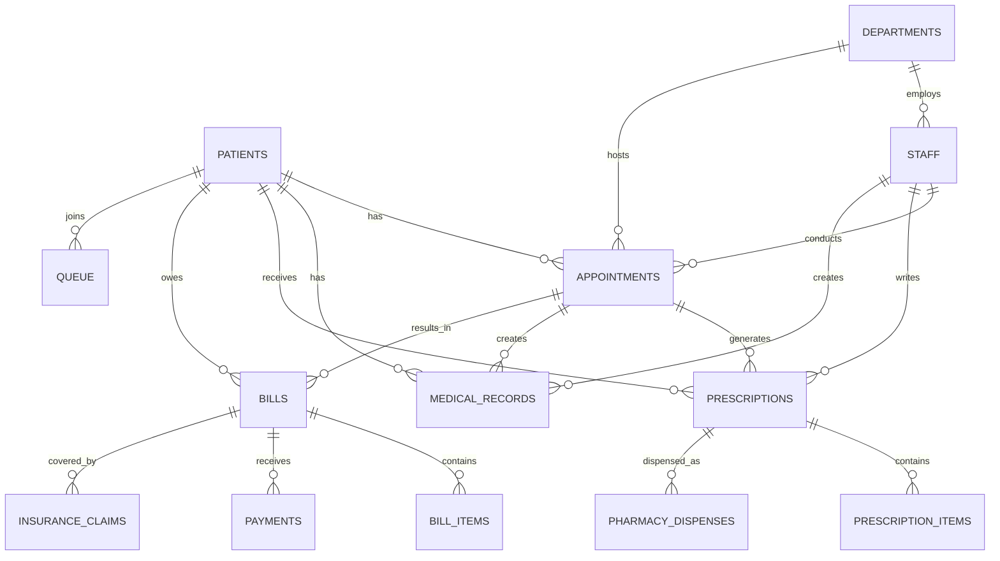

# Design Document

## Overview

The Hospital Management System (HMS) is a comprehensive WordPress plugin designed to provide enterprise-level healthcare facility management. The system follows a modular architecture with clear separation of concerns, utilizing WordPress best practices for admin interface design, database management, and user role management.

The design leverages the existing WordPress admin framework while providing specialized healthcare workflows for patient management, clinical operations, billing, pharmacy, and reporting. The system is built with scalability, security, and user experience as primary considerations.

## Architecture

### System Architecture Pattern

The HMS follows a **Layered Architecture** pattern with the following layers:

1. **Presentation Layer**: WordPress admin interface with custom templates
2. **Business Logic Layer**: Core HMS classes handling domain-specific operations
3. **Data Access Layer**: WordPress database abstraction (WPDB) with custom table management
4. **Database Layer**: MySQL with WordPress table prefix conventions

### Core Components Structure

```
hospital-management-system/
├── hospital-management-system.php (Main plugin file)
├── admin/
│   ├── class-hms-admin.php (Admin controller)
│   ├── templates/ (Admin page templates)
│   ├── css/ (Admin styling)
│   └── js/ (Admin JavaScript)
├── includes/
│   ├── class-hms-*.php (Core business logic classes)
│   └── trait-hms-queue-manager.php (Shared functionality)
├── public/
│   ├── class-hms-public.php (Public-facing functionality)
│   └── templates/ (Public templates)
└── languages/ (Internationalization files)
```

### Database Architecture

The system uses a **normalized relational database design** with the following core entities:

- **Patients**: Central entity linking to all other modules
- **Staff**: Healthcare providers and administrative personnel
- **Appointments**: Scheduling and patient-doctor interactions
- **Medical Records**: Clinical documentation and patient history
- **Prescriptions**: Medication management and dispensing
- **Billing**: Financial transactions and insurance claims
- **Pharmacy**: Inventory and medication dispensing
- **Departments**: Organizational structure
- **Queue**: Patient flow management

## Components and Interfaces

### 1. Plugin Activation and Database Management

**Component**: `HMS_Activator` class
**Interface**: WordPress activation hooks

```php
class HMS_Activator {
    public static function activate()
    public static function create_tables()
    public static function create_roles()
    public static function set_default_options()
    public static function populate_default_departments()
}
```

**Key Features**:
- Automatic database table creation with proper charset/collation
- WordPress role and capability management
- Default data seeding (departments, settings)
- Migration system for schema updates
- Rollback capabilities for failed activations

### 2. Patient Management System

**Component**: `HMS_Patient` class
**Interface**: CRUD operations with WordPress admin integration

```php
class HMS_Patient {
    public function register_patient($data)
    public function get_patient($id)
    public function update_patient($id, $data)
    public function delete_patient($id)
    public function get_patients_list($filters = [])
    public function get_patient_medical_history($patient_id)
    public function search_patients($query)
}
```

**Admin Interface Design**:
- DataTables integration for patient listing with search/filter
- Modal forms for quick patient registration
- Tabbed interface for patient details (Personal, Medical, Billing)
- Breadcrumb navigation for hierarchical access
- Quick action buttons (View, Edit, Delete, Medical History)

### 3. Appointment Management

**Component**: `HMS_Appointments` class
**Interface**: Calendar integration with conflict detection

```php
class HMS_Appointments {
    public function create_appointment($data)
    public function get_appointment($id)
    public function update_appointment($id, $data)
    public function cancel_appointment($id)
    public function get_appointments_by_date($date)
    public function get_doctor_schedule($doctor_id, $date)
    public function check_availability($doctor_id, $date, $time)
}
```

**Design Features**:
- Calendar view with drag-and-drop rescheduling
- Conflict detection and availability checking
- Automated patient and doctor notifications
- Integration with queue management system
- Recurring appointment support

### 4. Prescription Management

**Component**: `HMS_Prescription` class
**Interface**: Medical workflow integration

```php
class HMS_Prescription {
    public function create_prescription($data)
    public function add_prescription_item($prescription_id, $medicine_data)
    public function get_prescription($id)
    public function get_patient_prescriptions($patient_id)
    public function update_prescription_status($id, $status)
    public function generate_prescription_pdf($id)
}
```

**Design Features**:
- Medicine database with dosage and interaction checking
- Template-based prescription generation
- Digital signature integration
- Pharmacy integration for dispensing workflow
- Prescription history tracking

### 5. Medical Records Management

**Component**: `HMS_Clinical` class
**Interface**: Clinical documentation system

```php
class HMS_Clinical {
    public function create_medical_record($data)
    public function get_medical_record($id)
    public function update_medical_record($id, $data)
    public function get_patient_records($patient_id)
    public function search_records($criteria)
    public function generate_medical_summary($patient_id)
}
```

**Design Features**:
- Rich text editor for clinical notes
- Template-based record forms by specialty
- Attachment support for medical images/documents
- Version control for record modifications
- Search and filtering by diagnosis, symptoms, treatments

### 6. Billing and Invoice Management

**Component**: `HMS_Billing` class
**Interface**: Financial management system

```php
class HMS_Billing {
    public function create_bill($data)
    public function add_bill_item($bill_id, $item_data)
    public function process_payment($bill_id, $payment_data)
    public function generate_invoice($bill_id)
    public function get_billing_summary($filters = [])
    public function handle_insurance_claim($bill_id, $insurance_data)
}
```

**Design Features**:
- Itemized billing with service codes
- Multiple payment method support
- Insurance claim processing workflow
- Automated invoice generation with hospital branding
- Payment tracking and reconciliation
- Financial reporting and analytics

### 7. Pharmacy Management

**Component**: `HMS_Pharmacy` class
**Interface**: Inventory and dispensing system

```php
class HMS_Pharmacy {
    public function dispense_medicine($prescription_id, $dispense_data)
    public function update_stock($medicine_id, $quantity)
    public function get_stock_levels()
    public function check_expiry_alerts()
    public function generate_stock_report()
    public function create_purchase_order($supplier_id, $items)
}
```

**Design Features**:
- Real-time inventory tracking
- Expiry date monitoring with alerts
- Barcode scanning integration
- Supplier management and purchase orders
- Dispensing workflow with prescription validation
- Stock level alerts and reorder automation

### 8. Insurance Management

**Component**: `HMS_Insurance` class
**Interface**: Claims processing system

```php
class HMS_Insurance {
    public function add_insurance_provider($data)
    public function update_provider($id, $data)
    public function create_claim($bill_id, $insurance_data)
    public function update_claim_status($claim_id, $status)
    public function get_claim_history($patient_id)
    public function generate_claim_report()
}
```

**Design Features**:
- Provider database with TPA integration
- Automated claim submission workflows
- Pre-authorization management
- Claim status tracking and notifications
- Integration with billing system
- Reporting for claim analytics

### 9. Laboratory and Radiology Management

**Component**: `HMS_Lab_Radiology` class
**Interface**: Test ordering and results management

```php
class HMS_Lab_Radiology {
    public function order_test($patient_id, $test_data)
    public function update_test_status($test_id, $status)
    public function enter_test_results($test_id, $results)
    public function generate_lab_report($test_id)
    public function get_pending_tests()
    public function notify_results_ready($test_id)
}
```

**Design Features**:
- Test catalog with normal ranges
- Workflow management (Ordered → In Progress → Completed)
- Results entry with validation
- Report generation with hospital branding
- Integration with clinical records
- Critical value alerts and notifications

### 10. Clinical Dashboard

**Component**: `HMS_Clinical_Features` class
**Interface**: Unified clinical workspace

```php
class HMS_Clinical_Features {
    public function get_patient_summary($patient_id)
    public function get_recent_activities($filters = [])
    public function get_pending_tasks()
    public function get_clinical_alerts()
    public function generate_patient_timeline($patient_id)
}
```

**Design Features**:
- Unified patient view with all relevant information
- Real-time notifications and alerts
- Task management for clinical staff
- Quick access to frequently used functions
- Customizable dashboard widgets
- Integration with all clinical modules

### 11. Queue Management System

**Component**: `trait HMS_Queue_Manager`
**Interface**: Patient flow optimization

```php
trait HMS_Queue_Manager {
    public function add_to_queue($patient_id, $doctor_id)
    public function call_next_patient($doctor_id)
    public function update_queue_status($queue_id, $status)
    public function get_queue_status($doctor_id)
    public function estimate_wait_time($doctor_id)
}
```

**Design Features**:
- Real-time queue display with estimated wait times
- Token number generation and management
- Priority queue support for emergencies
- SMS/WhatsApp notifications for queue updates
- Doctor-specific queue management
- Analytics for queue optimization

### 12. Staff Management

**Component**: `HMS_Staff` class
**Interface**: HR and access control system

```php
class HMS_Staff {
    public function add_staff($data)
    public function update_staff($id, $data)
    public function deactivate_staff($id)
    public function get_staff_by_role($role)
    public function get_staff_schedule($staff_id)
    public function manage_permissions($staff_id, $permissions)
}
```

**Design Features**:
- Role-based access control integration
- Staff scheduling and availability management
- Performance tracking and reporting
- Document management (certifications, licenses)
- Integration with WordPress user system
- Audit trail for staff actions

### 13. Reporting and Analytics

**Component**: `HMS_Reports` class
**Interface**: Business intelligence system

```php
class HMS_Reports {
    public function generate_patient_report($filters = [])
    public function generate_financial_report($period)
    public function generate_clinical_report($department, $period)
    public function get_dashboard_metrics()
    public function export_data($module, $format)
    public function schedule_report($report_type, $schedule)
}
```

**Design Features**:
- Interactive dashboard with key performance indicators
- Customizable report generation with filters
- Multiple export formats (PDF, CSV, Excel)
- Scheduled report delivery via email
- Data visualization with charts and graphs
- Comparative analytics and trend analysis

### 14. System Settings and Configuration

**Component**: `HMS_Admin` class (Settings section)
**Interface**: Configuration management system

```php
class HMS_Admin {
    public function update_hospital_settings($data)
    public function manage_user_roles($role_data)
    public function configure_notifications($settings)
    public function setup_white_label_branding($branding_data)
    public function manage_integrations($integration_settings)
}
```

**Design Features**:
- Tabbed settings interface (General, Notifications, Branding, Advanced)
- Real-time settings validation
- Backup and restore configuration
- Integration management (SMS, Email, Payment gateways)
- White-label customization options
- System health monitoring

## Data Models

### Core Entity Relationships



### Database Schema Design Principles

1. **Normalization**: Third normal form (3NF) to eliminate data redundancy
2. **Indexing**: Strategic indexes on frequently queried columns
3. **Constraints**: Foreign key relationships with cascade options
4. **Audit Trail**: Created/updated timestamps on all entities
5. **Soft Deletes**: Status-based deletion for data integrity
6. **Scalability**: Partitioning strategy for large datasets

## Error Handling

### Error Handling Strategy

1. **Validation Layer**: Input validation at form and API levels
2. **Business Logic Layer**: Domain-specific error handling
3. **Database Layer**: Transaction management and rollback
4. **User Interface Layer**: User-friendly error messages
5. **Logging Layer**: Comprehensive error logging and monitoring

### Error Types and Responses

```php
class HMS_Error_Handler {
    const VALIDATION_ERROR = 'validation_error';
    const DATABASE_ERROR = 'database_error';
    const PERMISSION_ERROR = 'permission_error';
    const BUSINESS_LOGIC_ERROR = 'business_logic_error';
    
    public function handle_error($error_type, $message, $context = [])
    public function log_error($error)
    public function display_user_message($error)
    public function send_admin_notification($critical_error)
}
```

### User Experience Error Handling

- **Graceful Degradation**: System continues to function with reduced features
- **Progressive Enhancement**: Advanced features fail safely
- **User Feedback**: Clear, actionable error messages
- **Recovery Options**: Suggestions for resolving errors
- **Offline Support**: Basic functionality during connectivity issues

## Testing Strategy

### Testing Pyramid Approach

1. **Unit Tests**: Individual class and method testing
2. **Integration Tests**: Module interaction testing
3. **System Tests**: End-to-end workflow testing
4. **User Acceptance Tests**: Real-world scenario validation

### Test Coverage Areas

#### Unit Testing
- Data validation functions
- Business logic calculations
- Database query methods
- Utility functions

#### Integration Testing
- WordPress hook integration
- Database transaction workflows
- Third-party API integrations
- Email and SMS notifications

#### System Testing
- Complete patient registration workflow
- Appointment scheduling and management
- Billing and payment processing
- Prescription and pharmacy workflows
- Report generation and export

#### Performance Testing
- Database query optimization
- Large dataset handling
- Concurrent user scenarios
- Memory usage optimization

### Testing Tools and Framework

```php
// PHPUnit configuration for HMS testing
class HMS_Test_Suite extends WP_UnitTestCase {
    public function setUp()
    public function tearDown()
    public function test_patient_registration()
    public function test_appointment_scheduling()
    public function test_billing_workflow()
    public function test_prescription_management()
}
```

### Automated Testing Pipeline

1. **Pre-commit Hooks**: Code quality and basic tests
2. **Continuous Integration**: Full test suite on code changes
3. **Staging Environment**: Integration testing with real data
4. **Production Monitoring**: Performance and error tracking

## Security Considerations

### WordPress Security Integration

1. **Nonce Verification**: All form submissions protected
2. **Capability Checks**: Role-based access control
3. **Data Sanitization**: Input cleaning and validation
4. **SQL Injection Prevention**: Prepared statements only
5. **XSS Protection**: Output escaping and validation

### Healthcare-Specific Security

1. **HIPAA Compliance**: Patient data protection measures
2. **Audit Logging**: Complete action tracking
3. **Data Encryption**: Sensitive data encryption at rest
4. **Access Controls**: Granular permission system
5. **Session Management**: Secure session handling

### Security Implementation

```php
class HMS_Security {
    public function verify_nonce($action)
    public function check_user_capability($capability)
    public function sanitize_input($data, $type)
    public function encrypt_sensitive_data($data)
    public function log_user_action($action, $context)
    public function validate_file_upload($file)
}
```

## Performance Optimization

### Database Optimization

1. **Query Optimization**: Efficient SQL queries with proper indexing
2. **Caching Strategy**: WordPress object caching integration
3. **Pagination**: Large dataset handling with pagination
4. **Connection Pooling**: Database connection management
5. **Query Monitoring**: Performance tracking and optimization

### Frontend Optimization

1. **Asset Minification**: CSS and JavaScript optimization
2. **Lazy Loading**: On-demand content loading
3. **AJAX Implementation**: Asynchronous operations
4. **Caching Headers**: Browser caching optimization
5. **CDN Integration**: Static asset delivery optimization

### Scalability Considerations

1. **Modular Architecture**: Independent module scaling
2. **Database Partitioning**: Large table management
3. **Load Balancing**: Multi-server deployment support
4. **Microservices Ready**: API-first design approach
5. **Cloud Integration**: Cloud storage and services support

This design provides a comprehensive foundation for implementing the HMS enterprise features while maintaining WordPress best practices and ensuring scalability, security, and maintainability.